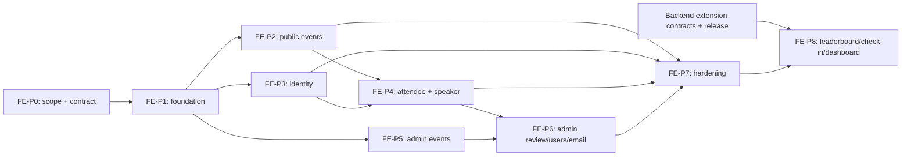

# FCAJ Frontend Rebuild Plan

> Kế hoạch viết lại FE theo phong cách phase/release có tiêu chí chấp nhận, tương tự roadmap backend trong `fcajdn-page/docs/SYSTEM_DESIGN.md` §16. Backend v1.3 và SPA React hiện có là baseline tham chiếu. Không sửa backend trong các phase này. Leaderboard/karma và QR check-in bị loại khỏi build scope đến khi có backend contract.

## G0 — Scope, contract và baseline

**Mục tiêu:** chốt product scope/UI ↔ API trước khi thay code.

**Công việc:** kiểm kê route hiện tại, DTO/API client, components, design tokens; lập mapping tất cả Stitch screens sang route/endpoint; chốt navigation/role; quyết định admin overview tạm dùng gì; loại placeholder không có API.

**Tiêu chí hoàn thành:** API-01..48 được map với route/action phù hợp; danh sách trạng thái và field lấy từ `frontend/src/types/api.ts`; các capability gaps được ghi nhận; được product duyệt scope và thứ tự ưu tiên.

**Gate:** chưa triển khai UI trước khi chốt scope cho các mục leaderboard, check-in, karma và dashboard.

## FE-P1 — Foundation, shell và design system

**Mục tiêu:** tạo nền UI nhất quán mà không đổi contract backend.

**Công việc:** apply DESIGN.md tokens; typography/spacing/responsive; public/admin shells; primitives/forms/feedback; typed status badges; route-level loading/error boundaries; accessibility baseline.

**Tiêu chí hoàn thành:** mọi route có shell/nav đúng role; keyboard focus rõ; mobile nav hoạt động; shared states/components dùng lại; không có dead link; session unauthorized behavior cùng AuthContext.

## FE-P2 — Public discovery and event detail

**Mục tiêu:** thay màn 01/02/17/18 bằng flow chạy dữ liệu thật.

**Công việc:** event discovery, pagination/filters API-supported, event detail, public program, deadline/capacity messaging, cancelled/completed/closed/full states, responsive CTA.

**Tiêu chí hoàn thành:** event cards/detail lấy API-14..16; mọi CTA theo status/capability; timezone rõ; online URL chỉ lộ khi backend cho phép; không còn mock counters hoặc event records.

## FE-P3 — Identity and account

**Mục tiêu:** auth và account end-to-end.

**Công việc:** register/login/verify/resend/forgot/reset/logout-all; account/profile/password; notification preferences; unsubscribe; suspended/expired states.

**Tiêu chí hoàn thành:** API-01..13 tích hợp; xử lý generic auth response đúng; 401/403/validation/network/429 phản hồi rõ; refresh account/preferences sau save; không có token trong URL/log/storage ngoài cơ chế session đã duyệt.

## FE-P4 — Attendee and speaker journeys

**Mục tiêu:** đăng ký tham dự và đề xuất diễn giả.

**Công việc:** attendee register/cancel; my participation tab attendee/speaker; submission create/edit/withdraw/detail; upload lifecycle và download; state-specific CTAs.

**Tiêu chí hoàn thành:** API-17..29 tích hợp; hai participation type tách rõ; server pagination đúng; upload file trực tiếp presigned URL; xử lý full/closed/expired/conflict; không hiển thị QR/check-in/absent.

## FE-P5 — Admin event operations

**Mục tiêu:** thay màn 10/12/15 và admin overview bằng công cụ event thật.

**Công việc:** admin event list/create/edit/detail/publish/cancel/delete draft; attendees; notification summary. KPI overview chỉ dùng nếu có source chính xác; nếu không, landing page là action-oriented admin home (danh sách event gần đây/CTA) hoặc redirect events.

**Tiêu chí hoàn thành:** API-30..37 tích hợp; phân biệt draft/published/cancelled/completed; xác nhận destructive actions; pagination/filter server; không mô phỏng check-in/export.

## FE-P6 — CFP review, users and email operations

**Mục tiêu:** hoàn tất tác vụ quản trị có API.

**Công việc:** queue/detail/approve/reject CFP; user list/detail/suspend/reactivate; failed email list/retry; notification summary.

**Tiêu chí hoàn thành:** API-38..48 tích hợp; bắt buộc review note khi từ chối; xử lý speaker cap conflict; file admin tải qua signed URL; status/retry phản ánh kết quả server; không tạo karma score/dashboard totals giả.

## FE-P7 — Integration hardening and release readiness

**Mục tiêu:** bảo đảm app hoàn chỉnh với backend cùng-origin deployment.

**Công việc:** rà route refresh/fallback, `/api/v1` base, API JSON errors, CSP/storage presigned upload constraints, responsive/keyboard review, empty/error/loading pass, copy review tiếng Việt, bundle/deployment check.

**Tiêu chí hoàn thành:** tất cả menu/CTA trỏ route thật; direct deep-link và reload cùng-origin hoạt động; API 404 là JSON, route SPA render đúng; không lộ PII/private URL; no-op/unsupported features không lộ; release notes và migration-from-old-UI mapping được ghi lại.

## FE-P8 — Conditional product extensions (blocked on backend)

**Mục tiêu:** bổ sung màn chưa được backend hỗ trợ sau khi backend feature đã được thiết kế, triển khai và phát hành.

**In scope:** (a) leaderboard + karma ledger/summary; (b) ticket/QR generation and secure check-in; (c) dashboard metrics API nếu sản phẩm yêu cầu.

**Entry criteria:** backend contract, authz, privacy, audit/idempotency, migration, tests, deploy and API types đã sẵn sàng. Không bắt đầu FE-only mock để giả lập khả năng.

**Acceptance:** theo contract đã duyệt; UI thể hiện invalid/already used/permission denied/network and retry cases; kiểm tra camera permission/manual fallback cho check-in.

## Dependency map

## Cutover and risk controls

- Keep API DTOs aligned to `frontend/src/types/api.ts`; update type definitions from backend contract, not screenshots.
- Prefer incremental route-by-route replacement; keep current app runnable until each phase acceptance is met.
- Do not change API paths or auth semantics as a side effect of visual rebuild.
- Use server values for state/capacity and treat 409 as normal concurrency feedback.
- Primary product risk is mismatch between the broad prototype and narrower backend; G0 must remove unsupported features from release scope.
- Existing frontend is already implemented. Before starting rewrite, compare current pages/components against this phase plan and reuse compliant API/auth/upload logic; avoid reimplementing backend integration without a reason.

## Explicitly deferred

- Leaderboard and karma (no schema/rules/API).
- QR ticket and check-in, checked-in/absent state (no schema/API).
- Global admin dashboard metrics (no summary endpoint); use precise existing data or omit aggregate figures.
- Admin system settings beyond existing event/user/email/preferences capabilities.

